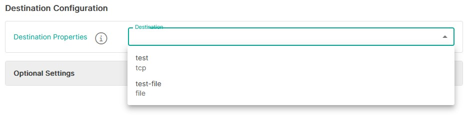
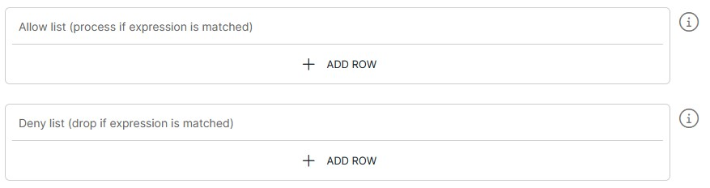
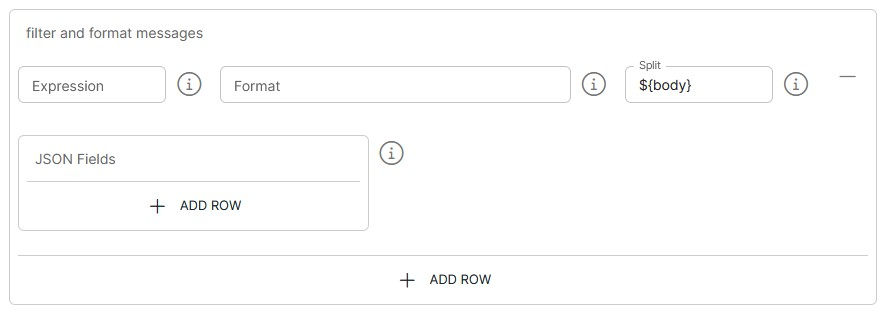

<p align="center">

</p>
<br><br>

# SCOM to TCP Listener (piscom-to-tcp v1.0)

**Important:** _These instructions assume you have Integration Hub v3.2+ installed_

- For help installing [Integration Hub](https://docs.interlinksoftware.com/ih/latest/index.html), see the [Installation Guide](https://docs.interlinksoftware.com/ih/latest/install/install_overview.html).

## Overview

The piscom-to-tcp template connects to one or more SCOM (iiSCOM2007) hosts over TCP and receives their alert events. The integration-hub pipeline filters and transforms each event, then sends it to the target TCP listener.

When several SCOM hosts are configured, the pipeline connects to all of them. The first live connection becomes the master; the others stay connected as backups. If the master connection drops, a live backup takes over.

Connections to SCOM hosts are plain TCP. TLS is not supported.

## Prerequisites

Before creating the pipeline you will need have the following configured:

- An [Output Target](https://github.com/interlinksoftware/integrationhub/tree/main/templates/syslog-to-tcp#defining-an-output-target), defining the destination for the processed data.

- The template is installed and is available within the user interface. Install directly from github or transfer the template to your Integration Hub server.

  - Installing directly from Github:

    ```
    ih-cli template import https://raw.githubusercontent.com/interlinksoftware/integrationhub/main/templates/piscom-to-tcp/1.0/piscom-to-tcp~1.0.yml
    ```

  - Install from local file. Place the template file in the `integration-hub/config/templates` directory, then run:

    ```
    ih-cli template import <path to template file>
    ```

  **Note:** _You will need to reload the configuration after importing a template before you can use it, to do this run:_

  ```
  ih-cli config reload
  ```

## Configuration

From the Pipelines section of the user interface you can create, update and delete pipelines. The following properties can be set for your pipeline.

### SCOM Connector

| Property               | Description                                                      |
| :--------------------- | :--------------------------------------------------------------- |
| `SCOM Hosts`           | Comma-separated list of SCOM hosts to connect to, as `host:port` (e.g. `scom1.example.com:24002,scom2.example.com:24002`) |
| `Timeout (s)`          | Socket read timeout in seconds. Default is 30                    |
| `Heartbeat Interval (s)` | Interval in seconds between heartbeat pings. Default is 5      |
| `Connect Timeout (s)`  | TCP connect timeout in seconds. Default is 10                    |

**Note:** _Any other pipeline that sends to the same SCOM hosts must use exactly the same `SCOM Hosts` value, so that both pipelines share one connection._

### Destination Configuration

The destination configuration specifies where the processed data should be sent. You can choose a single output target or configure multiple targets as needed.



### Optional Settings

#### Allow / Deny List

You can choose which SCOM events are processed and sent by configuring the Allow/Deny list. Each entry is an [expression](../../syslog-to-tcp/2.2#expression-syntax). Presets can be used in place of, or as well as, individual expressions.



- Allow List: only events that match an expression are processed.
- Deny List: events that match an expression are dropped.

#### Filters

The filter and formatting logic lets you customise how events appear when they are sent to the TCP listener. Filters can also send matching events to their own Output Targets.



| Property               | Description                                                      |
| :--------------------- | :--------------------------------------------------------------- |
| `Newline Placeholder`  | Replace newline characters with this value. Default is a single space |
| `Blank Placeholder`    | Replace blank values with this value. Default is `N/A`           |
| `Field Limit`          | Maximum number of characters in each field of the incoming message. Default is 256 |
| `Message Limit`        | Maximum number of characters in the message after it has been formatted. Default is 4096 |

#### Format

The incoming message is the SCOM event line, with its `- <id>` envelope removed, for example:

```
IntegrationId | Status = NEW | ManagementGroupName = MG1 | Name = Test Alert | Severity = 2 | ...
```

When no filter matches, the default `${auto}` format sends the event followed by its headers:

```
= <SCOM event line> | PiScomHost = VALUE | PiScomRawMessage = VALUE | PiScomMessageId = VALUE | ... | pipelineName = VALUE |
```

The following headers are available to filters and formats as `${header.NAME}`:

| Header                 | Description                                                      |
| :--------------------- | :--------------------------------------------------------------- |
| `PiScomRawMessage`     | The line exactly as received from SCOM, including the `- <id>` envelope |
| `PiScomMessageId`      | The id from the envelope                                         |
| `PiScomHost`           | The `host:port` the event came from                              |

#### Logging

| Property               | Description                                                      |
| :--------------------- | :--------------------------------------------------------------- |
| `UI Message Limit`     | Number of received/dropped/processed/sent/failed messages to show in the user interface. Default is 200 |
| `log messages received` | Log every event received from SCOM to `logs/<pipeline name>-<yyyymmdd>.received` |
| `log dropped messages` | Log events dropped by the Allow/Deny list to `logs/<pipeline name>-<yyyymmdd>.dropped` |
| `log processed messages` | Log events after formatting to `logs/<pipeline name>-<yyyymmdd>.processed` |
| `log failed messages`  | Log events that failed to process or send to `logs/<pipeline name>-<yyyymmdd>.failed` |

Events sent successfully are always logged to `logs/<pipeline name>-<yyyymmdd>.sent`.
