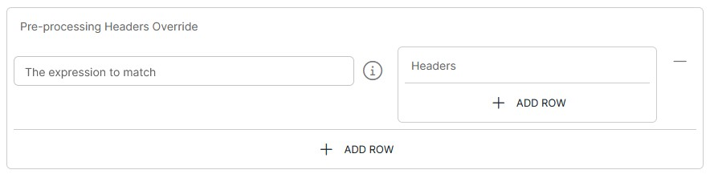
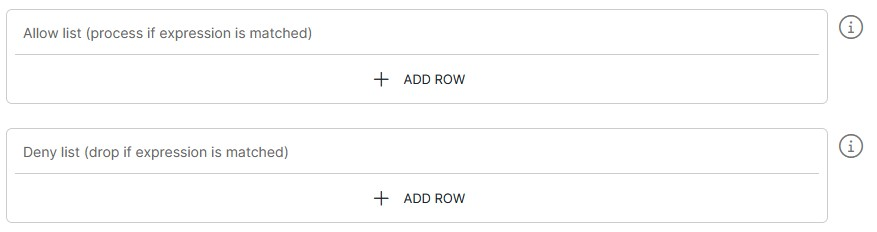

<p align="center">

</p>
<br><br>

# Webhook to AlertServer (webhook-to-alertserver v1.1)

**Important:** _These instructions assume you have Integration Hub v3.2+ installed_

- For help installing [Integration Hub](https://docs.interlinksoftware.com/ih/latest/index.html), see the [Installation Guide](https://docs.interlinksoftware.com/ih/latest/install/install_overview.html).

## Overview

The webhook-to-alertserver template provides functionality to transfer, filter/transform and send from webhook listener to alertserver, via an integration-hub pipeline.

Each incoming request is matched against your filters. When a filter matches, the pipeline looks up the referenced BES alert and runs the filter's actions against it (assign, close, update a field, add a note, run SQL or run a command). The response to the caller summarises the result of every action.

### What's new in v1.1

- Every action type can be configured from the user interface.
- New action types: `updateField`, `updateDB` and `runCommand`.
- `assignAlert` deassigns an alert that is assigned to another operator before reassigning it.
- Throttling is enabled by default, and the `Enable Throttling` switch now works as labelled.
- `Close Type` is optional and defaults to `2` (closed by operator).
- Field help and examples throughout the configuration screen.
- The response returns the result of each action, see [Response](#response).
- Each log type can also be sent to Datahub.

## Prerequisites

Before creating the pipeline you will need have the following configured:

- The template is installed and is available within the user interface. Install directly from github or transfer the template to your Integration Hub server.

  - Installing directly from Github:

    ```
    ih-cli template import https://raw.githubusercontent.com/interlinksoftware/integrationhub/main/templates/webhook-to-alertserver/1.1/webhook-to-alertserver~1.1.yml
    ```

  - Install from local file. Place the template file in the `integration-hub/config/templates` directory, then run:

    ```
    ih-cli template import <path to template file>
    ```

  **Note:** _You will need to reload the configuration after importing a template before you can use it, to do this run:_

  ```
  ih-cli config reload
  ```

## Configuration

From the Pipelines section of the user interface you can create, update and delete pipelines. The following properties can be set for your pipeline.

### Webhook Listener

| Property               | Description                                                      |
| :--------------------- | :--------------------------------------------------------------- |
| `Protocol`             | The http protocol for the webhook listener                       |
| `Hostname / IP`        | Host/IP address to bind the listener to                          |
| `Port`                 | Port to bind the listener to                                     |

#### Optional Settings

| Property               | Description                                                      |
| :--------------------- | :--------------------------------------------------------------- |
| `Path`                 | The path to listen on for requests                               |
| `sslContextParameters` | Reference to the ssl configuration to enable SSL on the pipeline |
| `API Key`              | Only requests with this value in the `apiKey` header will be able to process data |

<br />

If `Enable Basic Auth` is set to `true`, you will be required to define a map of users and passwords who will be allowed to send requests to this listener

`Enable Throttling` is on by default. Requests over the limit are rejected with an error response. When it is enabled, the following properties apply:

| Property               | Description                                                      |
| :--------------------- | :--------------------------------------------------------------- |
| `Throttle Count`       | Maximum number of incoming messages that can be ingested within the defined throttle period |
| `Throttle Period`      | The time period during which the throttle count is valid for, e.g. `10s` or `1m` |

<br />

### Alert Lookup

When looking up an alert, this pipeline will first attempt to find the alert in the EventDaemon. If no alert is found, the Alert Lookup Datasource will be used.

Actions are only run against open alerts. If the alert is not found, or is closed, the request is rejected.

The following properties can be specified for Alert Lookup.

| Property                            | Description                                                      |
| :---------------------------------- | :--------------------------------------------------------------- |
| `Alert Lookup Datasource`           | The name of the datasource that will be used to lookup alerts<br /><br />_This datasource should be configured to use the **besdb** database. It is also used by the `updateDB` action_ |
| `EventDaemon Hostname / IP Address` | The hostname / IP address of the system that is running Event Daemon |
| `EventDaemon Port`                  | The port that the EventDaemon is listening on                    |

<br />

### Filter Configuration

Filters are checked in order, and the first filter whose expression matches is used. The following properties can be specified for the filters:

| Property                  | Description                                                      |
| :------------------------ | :--------------------------------------------------------------- |
| `Expression`              | The [expression](#expression-syntax) which determines the action to take based on the incoming message |
| `AlertId`                 | An expression that resolves to the BES alert id from the incoming message, for example `${body[alertId]}` |
| `Process Last Alert Only` | When enabled and the AlertId expression resolves to a list, only the last alert id is processed<br/><br/><blockquote><i>This feature is useful in cases where multiple objects share identical alert ids</i></blockquote> |

<br />

#### Actions

Each filter can run one or more actions. Every action field accepts an [expression](#expression-syntax), so values can be taken from the incoming message.

| Action Type   | Fields                                   | Description                                                      |
| :------------ | :--------------------------------------- | :--------------------------------------------------------------- |
| `assignAlert` | `Operator`                               | Assigns the alert to the BES operator. If the alert is assigned to another operator it is deassigned first. If it is already assigned to this operator, nothing is sent and the action is reported as `DROPPED` with status `409` |
| `closeAlert`  | `Operator`, `Close Type` (optional)      | Closes the alert on behalf of the BES operator. `Close Type` is optional and defaults to `2`, see [close types](#close-types) |
| `updateField` | `Field Name`, `Field Value`              | Sets a field on the alert to the given value                     |
| `addNote`     | `Note`                                   | Adds a note to the alert                                         |
| `updateDB`    | `SQL Statement`                          | Runs the SQL statement against the Alert Lookup Datasource. The action fails if no rows are updated |
| `runCommand`  | `Command`, `Arguments`, `Timeout (ms)`   | Runs a command on the Integration Hub server, from the Integration Hub config directory. `Arguments` are comma separated. `Timeout (ms)` defaults to `3600000` (1 hour) |

<br />

Values from the looked up alert are available to actions as `${exchangeProperty.loadedAlert[<field>]}`, and the alert id as `${exchangeProperty.alertId}`.

To add a note when assigning or closing an alert, add a separate `addNote` action to the same filter.

#### Close Types

| Close Type | Meaning                          |
| :--------- | :------------------------------- |
| `2`        | Closed by operator (default)     |
| `3`        | Closed by supervisor / remote    |
| `4`        | Closed by alert                  |
| `5`        | Closed by timeout                |
| `20`       | Closed by inactive               |
| `21`       | Closed by correlation            |

**Pipeline Example** (_Assigning a user to the Alert & adding a note_):

```yaml
filters:
  - expression: ${body[actionCode]} == 'ASSIGN'
    alertId: ${body[alertId]}
    actions:
      - actionType: assignAlert
        operator: ppadmin
      - actionType: addNote
        note: Received request code ${body[actionCode]} - Alert ${body[alertId]} has been assigned to ppadmin
```

**Pipeline Example** (_Closing an Alert & adding a note_):

```yaml
filters:
  - expression: ${body[actionCode]} == 'CLOSE'
    alertId: ${body[alertId]}
    actions:
      - actionType: closeAlert
        operator: ppadmin
      - actionType: addNote
        note: Received request code ${body[actionCode]} - Alert has been closed by ppadmin
```

### AlertServer Connection

The following properties can be specified for the AlertServer Connection.

| Property                    | Description                                   |
| :-------------------------- | :-------------------------------------------- |
| `AlertServer Hostname / IP` | The hostname or IP address of the AlertServer |
| `AlertServer Port`          | The port that AlertServer is listening on     |

<br />

### Response

When the actions have run, the caller receives a JSON response that summarises the result of each action:

```json
{
  "status": "successful",
  "returnCode": "0",
  "http": { "code": "200", "method": "POST" },
  "data": {
    "status": 200,
    "action": "COMPLETED",
    "requestId": "<request id>",
    "alertId": "<alert id>",
    "responses": [
      { "status": 200, "action": "SUCCESS", "actionType": "assignAlert", "message": "..." }
    ]
  }
}
```

| `status`       | `returnCode` | HTTP code | Meaning                         |
| :------------- | :----------- | :-------- | :------------------------------ |
| `successful`   | `0`          | `200`     | All actions completed           |
| `unsuccessful` | `2`          | `500`     | One or more actions returned a status of `400` or above (including `409` for an alert already assigned to the operator) |

Requests that are rejected before any action runs (incorrect API key, unknown content type, alert not found or closed, dropped by the allow/deny list) return an error body describing the reason.

### Optional Settings

#### Expression Syntax

Please be aware that the settings below make use of the following expression syntax

- Filters
- Actions
- Allow / Deny List
- Pre-process Headers

<br />

<table>
<tr>
    <th>Property</th>
    <th>Description</th>
</tr>
<tr valign="top">
    <td><code>Expression</code></td>
    <td>
        <blockquote><strong>field</strong> <i>operator</i> <strong>value</strong></blockquote>
        <br>
        <code>field:</code> The field that is referenced from the incoming message. To match this against the whole string, use <code>${bodyAs(String)}</code>
        <br>
        <code>value:</code> The value being tested against
        <br></br>
        <strong>operators:</strong>
        <br></br>
        <table>
            <tr>
                <th>Operator</th>
                <th>Description</th>
            </tr>
            <tr>
                <td><code>==</code></td>
                <td>equals</td>
            </tr>
            <tr>
                <td><code>=~</code></td>
                <td>equals (case insensitive)</td>
            </tr>
            <tr>
                <td><code>!=</code></td>
                <td>does not equal</td>
            </tr>
            <tr>
                <td><code>!=~</code></td>
                <td>does not equal (case insensitive)</td>
            </tr>
            <tr>
                <td><code>contains</code></td>
                <td>contains string</td>
            </tr>
            <tr>
                <td><code>!contains</code></td>
                <td>does not contain</td>
            </tr>
            <tr>
                <td><code>regex</code></td>
                <td>matches regex string</td>
            </tr>
            <tr>
                <td><code>!regex</code></td>
                <td>does not match regex string</td>
            </tr>
            <tr>
                <td><code>&&</code></td>
                <td>AND multiple expressions</td>
            </tr>
            <tr>
                <td><code>||</code></td>
                <td>OR multiple expressions</td>
            </tr>
        </table>
        <br>
        <strong>See examples below:</strong>
        <br></br>
        <table>
            <tr>
                <th>Expression</th>
                <th>Description</th>
            </tr>
            <tr>
                <td><code>${bodyAs(String)} regex '(?s)(.*?)'</code></td>
                <td>matches any string</td>
            </tr>
            <tr>
                <td><code>${bodyAs(String)} =~ 'this' && ${bodyAs(String)} !=~ 'that'</code></td>
                <td>incoming message contains 'this' but not 'that'</td>
            </tr>
            <tr>
                <td><code>${bodyAs(String)} =~ 'dog' || ${bodyAs(String)} !=~ 'cat'</code></td>
                <td>incoming message contains 'dog' or 'cat'</td>
            </tr>
            <tr>
                <td><code>${body[username]} == 'ppadmin'</code></td>
                <td>incoming message field 'username' equals 'ppadmin'</td>
            </tr>
            <tr>
                <td><code>${body[username]} != null</code></td>
                <td>incoming message field 'username' is not null</td>
            </tr>
            <tr>
                <td><code>${body[origindate]} == ${date:now:yyyyMMdd}</code></td>
                <td>incoming message field 'origindate' equals todays date</td>
            </tr>
        </table>
    </td>
</tr>
</table>

<br />

#### Pre-process Headers

The pre-process headers feature allow you to define a collection of [expressions](#expression-syntax) and headers for fine-tuning incoming data prior to processing.



<br />

| Parameter | Type                                                                                                                                                                                                                      |
| :-------- | :------------------------------------------------------------------------------------------------------------------------------------------------------------------------------------------------------------------------ |
| `Headers` | The headers to set when a defined expression matches <br /><br /> `Header Name`: The name of the header. For example: `Content-Type` <br /><br /> `Header Value`: The value of the header. For example `application/json` |

<br />

#### Allow / Deny List

You can control which messages are processed based on an [expression](#expression-syntax) by configuring the Allow/Deny list



<br />

#### Logging

| Parameter              | Type                                                                                                                                              |
| :--------------------- | :------------------------------------------------------------------------------------------------------------------------------------------------ |
| `logReceived`          | If enabled all messages received will be captured, the maximum number of entries is controlled by the `uiMessageLimit` property                   |
| `logDropped`           | If enabled all messages dropped will be captured, the maximum number of entries is controlled by the `uiMessageLimit` property                    |
| `logProcessed`         | If enabled all messages processed will be captured, the maximum number of entries is controlled by the `uiMessageLimit` property                  |
| `logSuccess`           | If enabled all messages that were successfuly sent will be captured, the maximum number of entries is controlled by the `uiMessageLimit` property |
| `logFailed`            | If enabled all messages that have failed will be captured, the maximum number of entries is controlled by the `uiMessageLimit` property           |
| `uiMessageLimit`       | Specifies the maximum number of messages to store for this pipeline, the default is `200`                                                         |
| `log<Type>ToDatahub`   | Each log type above has a matching option to also send its messages to Datahub                                                                    |
| `logDatahubDataSource` | The Datahub data source used when any of the Datahub logging options are enabled                                                                  |
