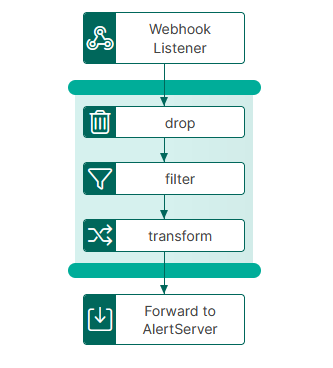

# webhook-to-alertserver Template

The webhook-to-alertserver template provides functionality to transfer, filter/transform and send from webhook listener to alertserver, via an integration-hub pipeline.

## Versions

| Version | Minimum Integration Hub version | Documentation |
| ------- | ------------------------------- | ------------- |
| `1.0`   | `2.2.0`                         | [Configuration and usage](1.0/) |
| `1.1`   | `3.2.0`                         | [Configuration and usage](1.1/) |
