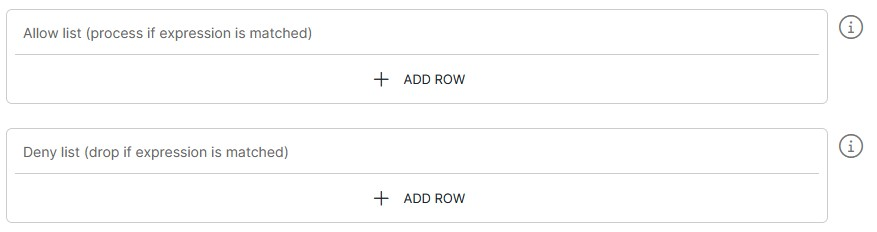

<p align="center">

</p>
<br><br>

# BES Work Files to SCOM (workfiles-to-piscom v1.0)

**Important:** _These instructions assume you have Integration Hub v3.2+ installed_

- For help installing [Integration Hub](https://docs.interlinksoftware.com/ih/latest/index.html), see the [Installation Guide](https://docs.interlinksoftware.com/ih/latest/install/install_overview.html).

## Overview

BES writes the alert events for each message channel to a work-files directory, for example `/opt/ISS/logs/bes/work/<mcname>`. Each file holds one event per line and is named by an epoch timestamp. When a file is full, BES starts a new one.

The workfiles-to-piscom template watches that directory and reads each new event line. The integration-hub pipeline filters each event with an Allow/Deny list and a list of event types, then sends it to iiSCOM.

The pipeline does not open its own SCOM connection. It sends events over the connection held by a [piscom-to-tcp](../../piscom-to-tcp/1.0) pipeline. Connections to SCOM hosts are plain TCP. TLS is not supported.

The pipeline saves its read position in a checkpoint file. After a restart it continues from where it stopped. On the first start, with no checkpoint, the Max Backfill settings choose which file to start from.

## Prerequisites

Before creating the pipeline you will need have the following configured:

- A running [piscom-to-tcp](../../piscom-to-tcp/1.0) pipeline connected to the same SCOM hosts. Both pipelines must use exactly the same `SCOM Hosts` value, so that they share one connection.

- Read access, for the Integration Hub service user, to the BES work-files directory.

- The template is installed and is available within the user interface. Install directly from github or transfer the template to your Integration Hub server.

  - Installing directly from Github:

    ```
    ih-cli template import https://raw.githubusercontent.com/interlinksoftware/integrationhub/main/templates/workfiles-to-piscom/1.0/workfiles-to-piscom~1.0.yml
    ```

  - Install from local file. Place the template file in the `integration-hub/config/templates` directory, then run:

    ```
    ih-cli template import <path to template file>
    ```

  **Note:** _You will need to reload the configuration after importing a template before you can use it, to do this run:_

  ```
  ih-cli config reload
  ```

## Configuration

From the Pipelines section of the user interface you can create, update and delete pipelines. The following properties can be set for your pipeline.

### Work Files Connector

| Property               | Description                                                      |
| :--------------------- | :--------------------------------------------------------------- |
| `Work Directory`       | The BES work-files directory to watch (e.g. `/opt/ISS/logs/bes/work/<mcname>`). Default is `/opt/ISS/logs/bes/work/Integrations` |
| `Event Types Allowed`  | Comma-separated event types to send to SCOM (e.g. `C, A, AN, P, R, UF`). An event is sent if it contains any of these tags. Leave empty to send every event that passes the Allow/Deny list. Default is `C,AN,A,UF` |

#### Optional Settings

| Property               | Description                                                      |
| :--------------------- | :--------------------------------------------------------------- |
| `Checkpoint Directory` | Directory for the checkpoint file. Must be writable. Default is `/tmp`; set a directory that survives a restart for production |
| `Poll Timeout (ms)`    | How often, in milliseconds, to check the directory for changes. Default is 1000 |
| `Pipeline Name`        | Names the checkpoint file (`<Pipeline Name>.cpf`). Give each pipeline that watches the same directory a different name. Default is `workfiles-to-piscom` |
| `Max Backfill (minutes)` | First start only: ignore files older than this. 0 means no limit. Default is 1440 (1 day) |
| `Max Backfill (file count)` | First start only: start no more than this many files back. 0 means no limit. Default is 0 |

### SCOM Connection

| Property               | Description                                                      |
| :--------------------- | :--------------------------------------------------------------- |
| `SCOM Hosts`           | Comma-separated list of SCOM hosts, as `host:port`. Must be exactly the same as the piscom-to-tcp pipeline's `SCOM Hosts` value |

#### Optional Settings

| Property               | Description                                                      |
| :--------------------- | :--------------------------------------------------------------- |
| `Timeout (s)`          | Socket read timeout in seconds. Default is 30                    |
| `Connect Timeout (s)`  | TCP connect timeout in seconds. Default is 10                    |
| `Heartbeat Interval (s)` | Interval in seconds between heartbeat pings. Default is 5      |
| `Command Timeout (s)`  | How long to wait for the iiSCOM reply to each event before the send fails. Default is 15 |

### Optional Settings

#### Allow / Deny List

You can choose which events are sent by configuring the Allow/Deny list. Each entry is an [expression](../../syslog-to-tcp/2.2#expression-syntax). Presets can be used in place of, or as well as, individual expressions.



- Allow List: only events that match an expression are sent.
- Deny List: events that match an expression are dropped.

The Allow/Deny list is applied first, then `Event Types Allowed`.

#### Logging

| Property               | Description                                                      |
| :--------------------- | :--------------------------------------------------------------- |
| `UI Message Limit`     | Number of received/dropped/processed/sent/failed messages to show in the user interface. Default is 200 |
| `log every event received` | Log every event read from the work files to `logs/<pipeline name>-<yyyymmdd>.received`. Default is off |
| `log events dropped by allow/deny or tag list` | Log events dropped by the Allow List, the Deny List or `Event Types Allowed` to `logs/<pipeline name>-<yyyymmdd>.dropped`. Each entry names the filter that dropped it. Default is off |
| `log events that passed all filters` | Log events that passed every filter, before they are sent, to `logs/<pipeline name>-<yyyymmdd>.processed`. Default is on |
| `log events sent to SCOM` | Log events sent to SCOM, with the iiSCOM reply, to `logs/<pipeline name>-<yyyymmdd>.sent`. Default is on |
| `log failed relay attempts` | Log events that could not be sent to SCOM, with the reason, to `logs/<pipeline name>-<yyyymmdd>.failed`. Default is on |

A send fails when the piscom-to-tcp pipeline has no live SCOM connection, or when iiSCOM does not reply within `Command Timeout (s)`. Each failed entry includes `backlogRemaining`, the number of work files still to be read.
